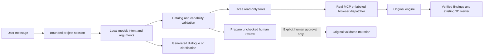

# Real local AI copilot

This upgrade lives on `real-ai-copilot`. Rescue Intelligence remains tagged `rescue-ready-2026-10-19` (`ea8be24`). The original assemblies, renderer, dependency engine and 22 MCP tools are preserved. Read [current evidence](REAL_AI_EVIDENCE.md) before making quality or hosting claims.

## Reproduce local inference

Requirements: Node.js 22+, npm, Ollama, a modern WebGL browser, and enough RAM/disk for the model. Evaluated on Windows, 16 GB RAM, i5-13420H and RTX 3050 Laptop 6 GB VRAM, with Ollama 0.40.6. Other hardware may be substantially slower.

```sh
git clone --branch real-ai-copilot https://github.com/ErickAmestegui/fixpilot-x.git
cd fixpilot-x
npm ci
ollama pull qwen2.5:7b
npm run dev:copilot
```

Keep Ollama running; a portable installation may require `ollama serve` in another terminal. Open `http://127.0.0.1:5173/?ai`. Choose **Connect local MCP**, then **Connect Ollama · Qwen2.5 7B**. The launcher starts Vite (5173), MCP (3101) and the AI adapter (3103); it does not install Ollama, download weights or start billing. Separate equivalents are `npm run dev`, `npm run mcp` and `npm run ai`.

Selected weights: **Qwen2.5 7B Instruct, qwen2.5:7b, 7.6B, Q4_K_M**, Apache 2.0. Observed digest: `845dbda0ea48ed749caafd9e6037047aa19acfcfd82e704d7ca97d631a0b697e`; download size 4,683,087,332 bytes. A mutable model tag may change: compare your digest with [recorded identity](ai-evidence/model-qwen25.json). Settings: temperature 0.2, top_p 0.8, top_k 20, min_p 0, context 8192, output limit 700 tokens, keep_alive 5m. No thinking parameter or silent model fallback is used.

## What is actually generative

A real local model interprets the current Spanish/English message, selects an action, extracts structured arguments, and generates conversational replies or clarification. There is no lookup table of conversational answers or natural-language phrase router in this AI path.

**Critical assembly findings are rendered directly from verified engine data, separately labeled, and are not model-authored explanations.** Earlier models invented shortages or misread step readiness when paraphrasing tool results. The final design gives the model intent/dialogue work and gives the engine authority over parts, dependencies, readiness and recorded progress. In the reliability follow-up, factual turns contain no model-authored acknowledgement or paraphrase: the interface shows verified findings only. Natural social dialogue, clarification and refusal remain model-generated. This deliberately limits free-form technical explanation; it does not claim arbitrary natural-language reasoning is reliable.



## MCP and controller boundaries

After connection the SDK initializes a real Streamable HTTP session, discovers 22 tools and transfers the current validated browser snapshot. The model controller can call only `preview_scenario`, `compare_scenarios` and `explain_recovery`. Each turn also performs a separately labeled initial context read. Without MCP connected, the same operations use the browser dispatcher and receipts explicitly say `local`.

The ordinary loopback `/chat` adapter is **not MCP**. The real MCP endpoint is `http://127.0.0.1:3101/mcp`, negotiating protocol `2025-11-25` in the observed run.

Every tool result must exactly match the original engine's calculation; mismatches are rejected, not silently replaced. Valid IDs, grounded resource references, independent exact comparison quotes and unchanged actual state are checked. Bounded syntax normalization and catalog quote repairs are recorded alongside raw model output. Unavailable work requests are redirected to a real recovery query. Invalid or ambiguous proposals request clarification. These safeguards improve bounded workflows; they do not guarantee arbitrary intent recognition.

The model never receives a mutation capability. It can only prepare an unchecked human review dialog. Inventory/progress updates remain original human actions with engine validation. Imported documents and model text cannot approve work. The software records user reports; it cannot inspect furniture or certify physical safety.

## Memory and failure behavior

Memory is separate per project and browser tab: at most 12 turns, two compact recent user/tool summaries in argument context, and six draft hypotheses. The intent router sees only the current message and project ID. New hypothesis edits merge with the prior draft; canceling only the latest edit restores the previous draft. Reload clears conversation memory; original project persistence is unchanged. No cloud or cross-device memory is claimed.

The UI shows the actual provider/model, generated text, timestamped engine findings, real tool receipts and actual versus hypothetical views. Model unavailable/busy/invalid replies produce an error, not a fake AI bubble. The deterministic command fallback is explicitly labeled. Old findings are snapshots at their turn, not live progress claims.

The adapter fixes its upstream to loopback Ollama, accepts only loopback hosts/origins, requires a custom client header, bounds request sizes and runs one generation at a time. No provider credentials or arbitrary upstream URL are accepted. This is a local development service, not a hardened public inference deployment.

## Checks and recording

```sh
npm test
npm run build
npm run test:e2e
# Opt-in: actual Ollama and MCP must already be running
npm run test:ai:live
# Fixed corpus: 32 new prompts + 11 regressions, all three runs saved
npm run test:ai:reliability -- --repeat 3
npm run demo:ai
```

The 32 new capability/protocol tests use explicit doubles; the two AI UI boundary tests mock the adapter. They are not real-model proof. The live evaluator never substitutes a mock and records actual model output, genuine MCP receipts, state invariance and scenario expectations. Its initial confirmations belong to a synthetic fixture. The UI recording uses actual services and explicit illustrative human reports, without response mocking or state injection. See the evidence report for completed results and failures.

## Costs, rejected candidates and limits

No paid API, cloud account or billing project was enabled. Actual inference used local downloaded weights with zero API charges. Existing hardware, electricity, disk space, connectivity and model-download time are still required. The public static Rescue preview does **not** run an LLM or a hosted MCP service. Real AI requires this local setup; no always-on free public inference is promised.

Qwen3 4B/8B configurations and a WebLLM Qwen3-1.7B candidate generated real outputs but failed quality checks during development. WebLLM was removed from the UI/dependencies. The generic qwen3:4b tag initially resolved to a thinking-only variant; disabling thinking there was a configuration mistake. Prompts/orchestration evolved, so these attempts are not a controlled ranking of models. Gemini was not connected because actual authorized quota and no-billing access were not verified.

Only the two existing educational assemblies are supported. Alexa+ remains simulated: no native Echo connection, private Amazon SDK, physical inspection or arbitrary-manual ingestion is claimed. Runtime/weights retain their own licenses; the app remains MIT.

Primary references: [Qwen2.5 model card](https://huggingface.co/Qwen/Qwen2.5-7B-Instruct), [Ollama model](https://ollama.com/library/qwen2.5:7b), [Ollama API](https://docs.ollama.com/api/chat). Recorded behavior and digests take precedence over assumptions about mutable tags.

## Reliability gate follow-up

The follow-up on the same branch replaces the forced first-route lock with semantic function selection, operation-specific native extraction, separate alternative parsing and semantic review. Raw native model calls and failed protocol diagnostics are retained. No public stable deployment changes. See [method and fixed acceptance rule](REAL_AI_RELIABILITY.md) and the timestamped records in `docs/ai-evidence/reliability/`. Review all repetitions and the manual assessment before updating any capability claim; extra mock tests are not real-model passes.
